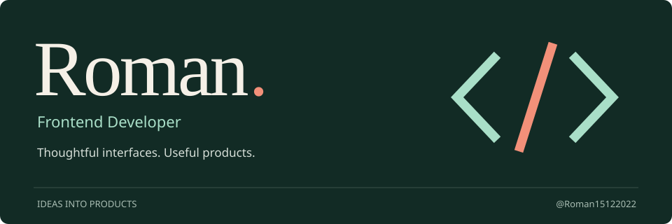
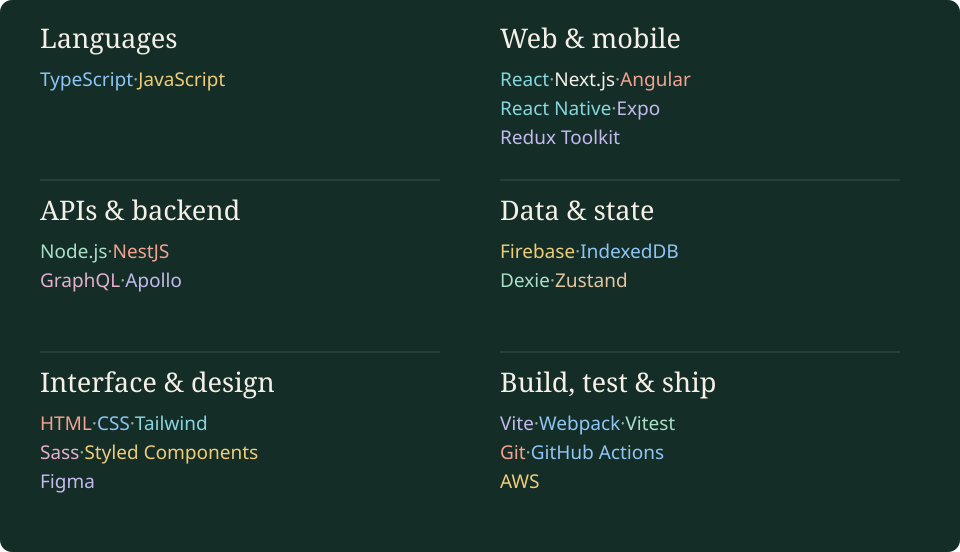
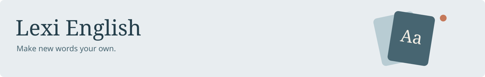
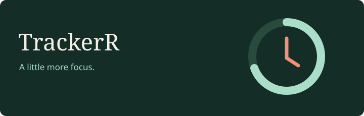
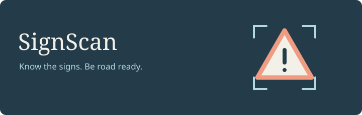
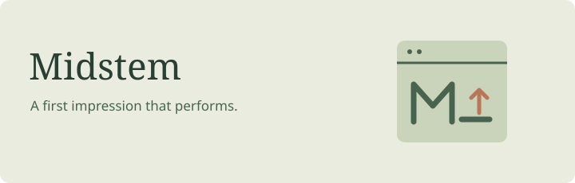

  

  <a href="#featured-projects"><strong>Featured projects</strong></a> &nbsp; / &nbsp;
  <a href="#more-things-ive-built"><strong>More work</strong></a> &nbsp; / &nbsp;
  <a href="https://github.com/Roman15122022?tab=repositories"><strong>Explore my GitHub ↗</strong></a>

 

## Hi, I'm Roman.

I build interfaces that turn everyday problems into useful products — from browser extensions and mobile experiences to offline web apps and full-stack tools.

I enjoy the whole journey: **a clear idea, thoughtful interactions, and the engineering that makes it work.**

 

## Tech stack

<picture>
  <source media="(max-width: 600px)" srcset="https://raw.githubusercontent.com/Roman15122022/Roman15122022/87ea52d6c5a3fa5df43c773837301fc9443ccf55/assets/tech-stack-mobile.svg" />
  
</picture>

 

## Featured projects

<table>
  <tr>
    <td colspan="2" valign="top">
       
      
      <h3><a href="https://lexi-english-six.vercel.app">Lexi English</a></h3>
      
A personal English vocabulary app with spaced-repetition flashcards, translations, pronunciation, and word imports. Learn offline, track your progress, and keep your vocabulary on your device — no account required.

      
<a href="https://lexi-english-six.vercel.app"><strong>Start learning ↗</strong></a>

       
    </td>
  </tr>
</table>

 

<table>
  <tr>
    <td width="50%" valign="top">
       
      
      <h3><a href="https://github.com/Roman15122022/React-redux-toolkit-extension">TrackerR</a></h3>
      
Your time, with a little more intention. A productivity extension with activity history, focus goals, achievements, and time statistics.

      
<a href="https://chromewebstore.google.com/detail/trackerr/nnjjpdjebmdlimpgjfegobcamnabdbfp"><strong>Get the extension ↗</strong></a> &nbsp; · &nbsp; <a href="https://github.com/Roman15122022/React-redux-toolkit-extension">Code</a>

       
    </td>
    <td width="50%" valign="top">
       
      
      <h3><a href="https://github.com/Roman15122022/ListOfProducts">Smart Shopping List</a></h3>
      
An offline-first shopping PWA with budgets, purchase history, pantry tracking, and recipe discovery. Your lists stay on your device.

      
<a href="https://roman15122022.github.io/ListOfProducts/"><strong>Try the app ↗</strong></a> &nbsp; · &nbsp; <a href="https://github.com/Roman15122022/ListOfProducts">Code</a>

       
    </td>
  </tr>
</table>

 

<table>
  <tr>
    <td width="50%" valign="top">
       
      
      <h3><a href="https://apps.apple.com/ua/app/signscan/id6461823283">SignScan</a></h3>
      
A mobile companion for learning road signs and preparing for driving theory exams. Practice traffic-rules (PDR) tests, identify signs with AI and learn what they mean, or explore the built-in sign library. Multiple subscription tiers offer different levels of access.

      
<a href="https://apps.apple.com/ua/app/signscan/id6461823283"><strong>App Store ↗</strong></a> &nbsp; · &nbsp; <a href="https://play.google.com/store/apps/details?id=com.signscan">Google Play ↗</a>

       
    </td>
    <td width="50%" valign="top">
       
      
      <h3><a href="https://midstem.net/">Midstem</a></h3>
      
A company landing page where presentation meets performance. My work includes developing and refining the site, improving page speed, providing ongoing support, and migrating between technologies to keep the experience moving forward.

      
<a href="https://midstem.net/"><strong>Visit the website ↗</strong></a>

       
    </td>
  </tr>
</table>

 

## More things I've built

### [Banner Manager](https://github.com/Roman15122022/test-fullstack-banners)

A full-stack banner-management app: image uploads, previews, validation, server-side pagination, and a multilingual interface. Angular on the frontend, NestJS behind the API.

[Explore the code ↗](https://github.com/Roman15122022/test-fullstack-banners)

---

### [Forms Lite](https://github.com/Roman15122022/test-task-google-form-clone)

Create forms, collect submissions, and explore responses. A full-stack form builder with a GraphQL API and shared, generated type contracts.

[Explore the code ↗](https://github.com/Roman15122022/test-task-google-form-clone)

---

### AutoCheckUp

A home for fuel expenses, maintenance history, and service contacts — with analytics to understand the cost of owning a car.

[Open the app ↗](https://autocheckup-34720.firebaseapp.com)

---

### [PokeAPI Explorer](https://github.com/Roman15122022/pockemon-info)

A Pokédex with search, filters, pagination, and a details drawer. Discover Pokémon and keep a collection of favorites between visits.

[Explore Pokémon ↗](https://roman15122022.github.io/pockemon-info/) &nbsp; · &nbsp; [Code](https://github.com/Roman15122022/pockemon-info)

---

### L2Calculator

A Lineage 2 toolkit for attribute damage penalties, currency conversion, gear upgrades, and experience calculations.

[Open the toolkit ↗](https://lineagee2unleashed.web.app)

---

### DevNotes

An everyday workspace for ideas and tasks, with accounts, drag-and-drop notes, and an interactive calendar.

[Explore the app ↗](https://nikemaks.github.io/DevNoteProximity/auth/sign-in) &nbsp; · &nbsp; [Code](https://github.com/Roman15122022/DevNoteProximity)

 

  <strong>Always curious. Always building.</strong>  
  <a href="https://github.com/Roman15122022?tab=repositories">All repositories ↗</a> &nbsp; · &nbsp;
  <a href="https://github.com/Roman15122022?tab=overview">Contribution history</a>

